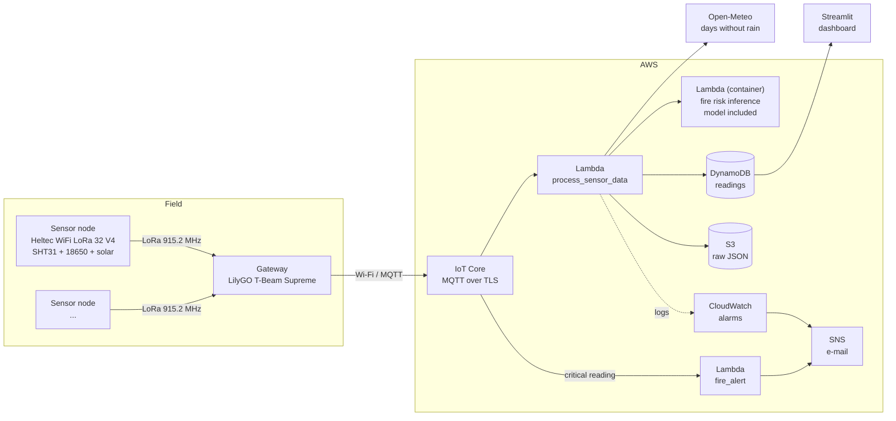

# Forest Fire IoT Monitor — Brazil

End-to-end forest fire risk monitoring: solar-powered LoRa sensor nodes measure temperature and humidity,
a gateway forwards the readings to AWS, a Random Forest model estimates the daily fire risk, and a
Streamlit dashboard plus e-mail alerts show the result.

> [!IMPORTANT]
> **This repository is configured for deployments in Brazil only.**
>
> - LoRa radio at **915.2 MHz** (ANATEL ISM bands 902–907.5 MHz and 915–928 MHz).
> - The "local day" used by the model is **Brasília time** (UTC−3).
> - The fire risk model (v1) was trained on **Brazilian data** (INMET weather stations × INPE fire foci).
>
> Deploying in any other country requires adapting, at least, the radio frequency, TX power and duty cycle
> to the local regulator, the timezone in `cloud/lambda/process_sensor_data/handler.py`, and a model trained
> on data from that country. See [Adapting to another country](#adapting-to-another-country).

## Architecture



1. Each node wakes every 30 min, reads the SHT31, sends one LoRa packet and goes back to deep sleep.
2. The gateway adds its timestamp and the RSSI and publishes to `forest-fire/<device_id>/sensors`.
3. `process_sensor_data` averages the node's last 24 h, gets the days without rain for the node's position
   from Open-Meteo, calls the inference Lambda and stores the result in DynamoDB (raw JSON goes to S3).
4. `fire_alert` sends an e-mail on instantaneous critical readings (temperature > 45 °C or humidity < 15 %).
5. CloudWatch alarms e-mail you when the risk reaches level 4–5, when a node goes silent for 2 h and when the
   pipeline receives nothing for 1 h.

## Repository layout

```
cloud/
  iac/terraform/          infrastructure (OpenTofu/Terraform)
  lambda/                 process_sensor_data and fire_alert
  streamlit/              dashboard
firmware/
  site_config.h.example   the only firmware file to edit (radio, nodes, Wi-Fi)
  node/                   sensor node (PlatformIO)
  gateway/                gateway (PlatformIO)
hardware/BOM.md           parts list and assembly
```

## Requirements

- Hardware: see [hardware/BOM.md](hardware/BOM.md).
- An AWS account and the [AWS CLI](https://aws.amazon.com/cli/) configured (`aws sts get-caller-identity`).
- [OpenTofu](https://opentofu.org/) or Terraform ≥ 1.5, [Docker](https://docs.docker.com/get-docker/) (running
  during `tofu apply`), [PlatformIO](https://platformio.org/) and Python 3.11+.
- A Wi-Fi network with internet access where the gateway is installed.

## Deploy

### 1. Infrastructure

```bash
git clone https://github.com/geeanderson/forest-fire-iot.git
cd forest-fire-iot/cloud/iac/terraform
cp terraform.tfvars.example terraform.tfvars   # set alert_email, a unique project_name and your nodes
tofu init
tofu apply
```

`terraform.tfvars` is the only file to edit for the cloud side. Declare every sensor node there once
(`nodes`: its `DEVICE_ID`, real position and, optionally, label and city): the position feeds the days without
rain, each node gets a silent-node alarm, and the dashboard's configuration is generated from it (step 4).

This creates DynamoDB, S3, SNS, the gateway's IoT Thing with its certificate, the IoT rules, the Lambdas and the
CloudWatch alarms. It also deploys the fire risk inference: the ready-to-run image (v1 Brazil model included,
see [Inference image](#inference-image)) is pulled from Docker Hub and copied to an ECR repository in your
account, because AWS Lambda only runs images from ECR. Keep Docker running while `tofu apply` runs.
**Confirm the subscription e-mail sent by SNS**, otherwise no alert is delivered.

> [!WARNING]
> `terraform.tfstate` and the Terraform outputs contain the devices' private keys. Never commit them
> (`.gitignore` already excludes them) and keep the state somewhere safe.

### 2. Gateway

All firmware settings you type, for the gateway and the nodes, live in a single file. Create it once and fill
in the Wi-Fi credentials of the gateway site (`WIFI_SSID`, `WIFI_PASSWORD`):

```bash
cp firmware/site_config.h.example firmware/site_config.h
```

The gateway's AWS IoT settings (endpoint, client ID, Amazon Root CA 1, its certificate and private key) are
generated by Terraform; nothing to copy by hand:

```bash
cd cloud/iac/terraform
tofu output -raw gateway_aws_config > ../../../firmware/gateway_aws.h
```

Both files are gitignored (`site_config.h` holds the Wi-Fi password, `gateway_aws.h` the private key). Then
flash the gateway:

```bash
cd firmware/gateway
pio run -t upload && pio device monitor
```

`LOGGER_SERVER_URL` is optional: define it only if you run your own HTTP logger in the same LAN for field
diagnostics. Left commented out (the default), the gateway sends to AWS only and its display shows the AWS
publish counters.

### 3. Sensor nodes

See [firmware/node/README.md](firmware/node/README.md). The nodes read the same `firmware/site_config.h`:
before flashing each one, set its unique `DEVICE_ID` (`node-01`, `node-02`, …) and its `BATTERY_ADC_SCALE`.
The radio settings are shared with the gateway, so they always match. The nodes talk only to the gateway, so
they need no certificates.

Each `DEVICE_ID` must also be declared in `nodes` (`terraform.tfvars`, step 1). To add a node later, add
it there and run `tofu apply` again; a node missing from `nodes` has its readings stored with the risk
"unavailable" and no silent-node alarm.

### 4. Dashboard

The dashboard needs no editing: step 1 already created a read-only IAM user for it (`dynamodb:Query` on the
readings table only), and its `secrets.toml` (credentials, region, table and nodes) is generated from your
Terraform configuration:

```bash
cd cloud/iac/terraform
tofu output -raw dashboard_secrets_toml > ../../streamlit/.streamlit/secrets.toml

cd ../../streamlit
pip install -r requirements.txt
streamlit run app.py
```

On [Streamlit Community Cloud](https://streamlit.io/cloud), paste the same content under **Settings → Secrets**
(Python 3.11 or newer). After changing `nodes` in `terraform.tfvars`, run `tofu apply` and generate the file
again. `secrets.toml` holds an AWS secret key: it is gitignored, never commit it.

To use your own AWS credentials instead, set `create_dashboard_user = false` in `terraform.tfvars` and replace
the two `REPLACE_WITH_...` keys in the generated file. On hosts other than Streamlit Cloud, the node list can also be
given as JSON in the `NODES_JSON` environment variable (`tofu output -raw dashboard_nodes_json`).

## Inference image

The fire risk runs in a ready-to-use container image, `inference_image` in
`cloud/iac/terraform/variables.tf`. It already holds the v1 Brazil model and its runtime; nothing has to be
built, downloaded or configured, and the image is meant to be used as is.

`process_sensor_data` invokes it with one reading (or `{"instances": [...]}` for several) and stores the
answer with the reading:

```json
{"temperature": 31.2, "humidity": 28.0, "days_without_rain": 21}
```

```json
{"fire_risk": [5], "fire_probability": [0.92], "model_version": "v1-br", "predictions": [1], "probabilities": [[0.08, 0.92]]}
```

## How the risk is computed

- Inputs: 24 h mean temperature and humidity of the node, and the days without rain at the node's position
  (Open-Meteo, up to 92 days back, counting complete local days).
- The model needs at least **36 valid readings in the last 24 h** (out of 48). Right after a node is
  installed, the dashboard shows "insufficient data" for about 18 h.
- Output: probability of an INPE fire focus within ~50 km on the day, mapped to levels 0–5
  (cuts at 10/30/50/70/90 %).
- Test results (2025): F1 0.710, ROC-AUC 0.759. Details in the paper below.

## Adapting to another country

| What | Where |
|---|---|
| LoRa frequency (used by the nodes and the gateway) | `firmware/site_config.h` (`LORA_FREQUENCY_MHZ`) |
| TX power, duty cycle and antenna gain limits | `firmware/site_config.h` (`LORA_TX_POWER_DBM`, `SLEEP_INTERVAL_SECONDS`) |
| Radio hardware for that band | [hardware/BOM.md](hardware/BOM.md) |
| Local day (timezone) | `_local_date()` and the Open-Meteo `timezone` in `cloud/lambda/process_sensor_data/handler.py` |
| Fire risk model | Your own Lambda container image with a model trained on local weather and fire data, answering the same request and response as the [inference image](#inference-image); set its address in `inference_image` |

The v1 model must not be used outside Brazil: weather and fire patterns differ, and its risk levels would
not be calibrated.

## Known limitations

- The model is trained on weather-station data and applied to readings from a probe a few metres above the
  ground; place the SHT31 in the shade (never in direct sun).
- Days without rain come from a weather model (Open-Meteo), not from a rain gauge, and are counted slightly
  differently from the training data.
- LoRa uses no acknowledgements: the node retries once only if the radio reports a failure; a packet lost
  over the air is simply missing until the next cycle.
- The MQ-135 air quality sensor is not part of this build (`air_quality` is a placeholder).
- Solar charging depends on the site: check the battery voltage on the dashboard during the first days.

## Citation

If you use this project, please cite:

> Amador dos Santos, R. G. and Marcon, M. (2026). An Integrated IoT Architecture for Real-Time Forest Fire
> Risk Monitoring and Early Warning Using LoRa, Cloud Computing and Machine Learning. In *Proceedings of the
> 23rd International Conference on Informatics in Control, Automation and Robotics (ICINCO 2026)* —
> Volume 2, pages 1169–1176. SCITEPRESS. ISBN 978-989-758-870-9, ISSN 2184-2809.

```bibtex
@inproceedings{amadordossantos2026forestfire,
  author    = {Amador dos Santos, Raimundo Geanderson and Marcon, Marlon},
  title     = {An Integrated IoT Architecture for Real-Time Forest Fire Risk Monitoring and Early Warning
               Using LoRa, Cloud Computing and Machine Learning},
  booktitle = {Proceedings of the 23rd International Conference on Informatics in Control, Automation and
               Robotics (ICINCO 2026)},
  volume    = {2},
  pages     = {1169--1176},
  publisher = {SCITEPRESS},
  year      = {2026},
  isbn      = {978-989-758-870-9},
  issn      = {2184-2809}
}
```

The paper itself is published by SCITEPRESS under CC BY-NC-ND 4.0 and is not part of this repository.

## Author

Raimundo Geanderson Amador dos Santos

## License

Copyright (C) 2026 Raimundo Geanderson Amador dos Santos

This program is free software: you can redistribute it and/or modify it under the terms of the
[GNU Affero General Public License v3.0](LICENSE) as published by the Free Software Foundation. It is
distributed WITHOUT ANY WARRANTY; see the license for details.

If you modify this software and make it available to users over a network (for example, a hosted
dashboard or API), the AGPL requires you to offer those users the corresponding source code.

Third-party files keep their own licenses: `firmware/gateway/src/LoRaBoards.*` and `utilities.h` are
MIT-licensed by LilyGO (see their headers).
